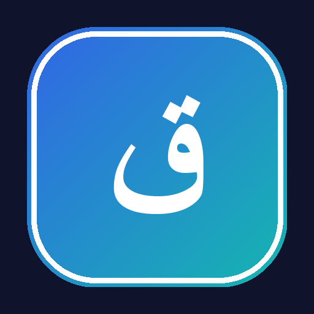

<p align="center"></p>
<h1 align="center">Qrayti · قرايتي</h1>
<p align="center"><strong>A student-first learning platform for Tunisia.</strong><br>تطبيق طلابي تونسي للتعلّم، المراجعة، وحساب المعدّل.</p>
<p align="center">
<a href="https://qrayti.pages.dev"><b>Live website</b></a> ·
<a href="https://qrayti.pages.dev/api/android"><b>Download Android</b></a> ·
<a href="CONTRIBUTING.md"><b>Contribute</b></a> ·
<a href="https://github.com/Amineakermii/Qrayti/issues"><b>Issues</b></a>
</p>
<p align="center">


</p>

## Built for real student life

Qrayti brings course discovery, native readers, offline downloads, favourites, history, semester calculations and beginner programming games into one fast RTL-first Android experience. The app and website share a Cloudflare-backed catalogue.

### What is inside

- Native Kotlin + Jetpack Compose Android app.
- Arabic-first RTL UI with light, dark and custom themes.
- Search by licence, year, semester and subject.
- PDF, image, text and Office-document opening flows.
- Offline downloads, favourites and continue-studying history.
- Clear Tunisian semester average calculator.
- **Code Quest:** 27 easy-English Java, C and Python missions.
- Verified automatic APK updates from the live website.
- Cloudflare Pages Functions, D1 catalogue metadata and R2 delivery.

## Repository map

```text
Qrayti/
├── app/       Android source, resources and tests
├── website/   Public frontend and safe Cloudflare functions
├── docs/      Owned project visuals
└── tools/     Publication safety checks
```

The private course library, admin credentials, signing keys, APK binaries and production Cloudflare IDs are intentionally not committed.

## Build Android

Requirements: Java 17, Android SDK API 36 and Gradle 8.13.

```powershell
gradle :app:testDebugUnitTest :app:lintDebug :app:assembleRc
```

On Windows, `BUILD-BETA-APK.bat` prepares the compatible local toolchain. Current public version: **1.12.0** (`versionCode 22`), Android 9+.

## Contribute

Small, focused pull requests are welcome. Read [CONTRIBUTING.md](CONTRIBUTING.md), open an issue for large changes, and never commit course documents, private student data or credentials.

## Educational content and rights

This repository contains source code, not the course library. Qrayti does not claim ownership of third-party educational material. Proposed learning resources need a clear source and permission from the relevant author, instructor or institution.
